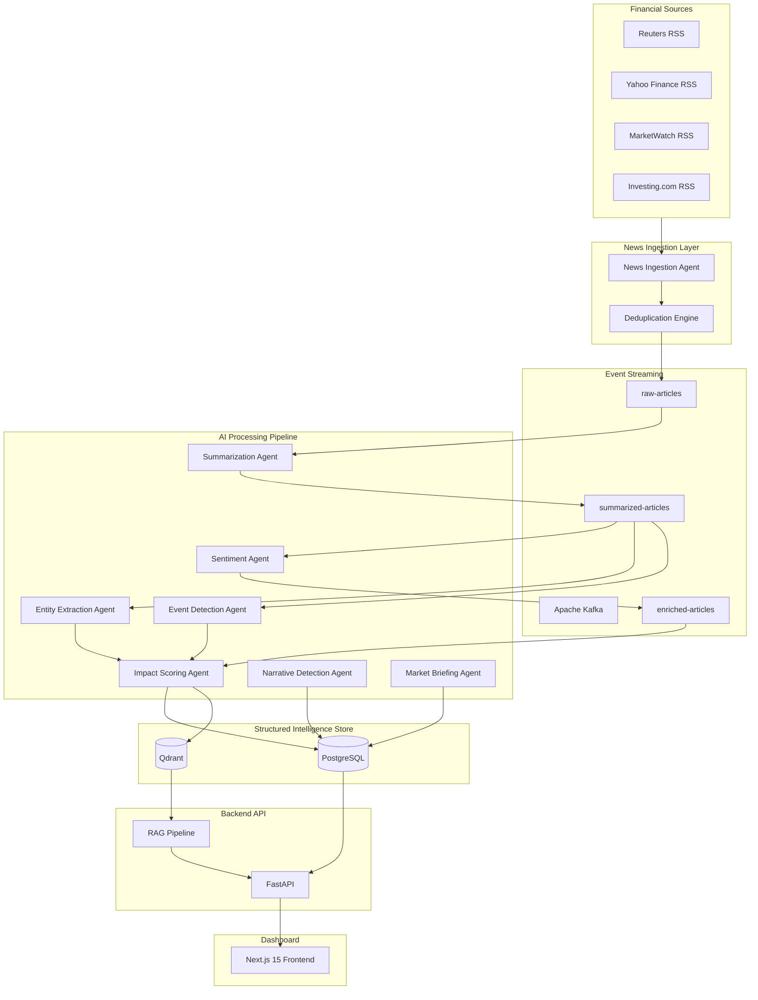

# MarketIQ — AI-Native Market Intelligence Platform

MarketIQ is a production-grade, AI-native market intelligence platform that continuously ingests financial news, normalizes articles, runs a series of AI agents to enrich them with sentiment and extracted events, clusters them into macro-market narratives, and embeds them into a vector database for semantic Retrieval-Augmented Generation (RAG) search and structured market briefings.

---

## 1. System Architecture



---

## 2. Technical Stack & Key Choices

- **Frontend**: Next.js 15, TypeScript, Tailwind CSS, Recharts (SSR-safe dynamic loads), Lucide React.
  - *Color Palette*: Custom **Silk / Ash / Granite / Caramel** theme (no generic blue/purple/black). Warm, organic, dark, high-end terminal styling.
- **Backend API**: FastAPI (fully asynchronous), SQLAlchemy 2.0 (asyncpg), Pydantic v2 validation.
- **Message Broker**: Apache Kafka (KRaft mode 4.0 – no ZooKeeper dependency) for microservice orchestration and stream buffering.
- **Vector Database**: Qdrant (similarity search, cosine distance, payload indices on sources and sentiment).
- **Relational Database**: PostgreSQL 17 (relational metadata, timelines, and reporting store).
- **AI/LLM**: LangChain, ChatGroq (`llama-3.3-70b-versatile`) for speed and structured outputs, Sentence Transformers (`BAAI/bge-base-en-v1.5` 768-dim) for finance-specific dense embeddings.

---

## 3. Scaffolding & Directory Structure

- [backend/app/main.py](file:///c:/Users/harry/OneDrive/Documents/ResP/MarketIQ/backend/app/main.py): Main entrypoint with async lifespan (database/Kafka/Qdrant collection setup), unified exceptions, and routing.
- [backend/app/dependencies.py](file:///c:/Users/harry/OneDrive/Documents/ResP/MarketIQ/backend/app/dependencies.py): Injectable services using FastAPI dependency injection.
- [backend/app/api/router.py](file:///c:/Users/harry/OneDrive/Documents/ResP/MarketIQ/backend/app/api/router.py): Root router mapping API resources (`/articles`, `/events`, `/narratives`, `/market-pulse`, `/briefings`, `/chat`, `/ingest`, `/companies`).
- [backend/app/agents/](file:///c:/Users/harry/OneDrive/Documents/ResP/MarketIQ/backend/app/agents/): AI Agents executing specific enrichment steps:
  - `IngestionAgent`: RSS stream parser (feedparser) & Kafka producer.
  - `SummarizationAgent`: Key takeaways extractor.
  - `SentimentAgent`: Multi-view sentiment and reasoning.
  - `EntityExtractionAgent`: Mentions of companies, sectors, and tickers.
  - `EventDetectionAgent`: Categorized event logging (acquisitions, earnings beats, layoffs).
  - `ImpactScoringAgent`: Authority-weighted 0-100 severity index.
  - `NarrativeDetectionAgent`: Periodical clustering.
  - `MarketBriefingAgent`: Periodical morning, daily, and weekly briefing composer.
- [frontend/src/app/page.tsx](file:///c:/Users/harry/OneDrive/Documents/ResP/MarketIQ/frontend/src/app/page.tsx): Silk-themed dashboard displaying market trends, gauges, heatmaps, and timelines.
- [frontend/src/app/news/page.tsx](file:///c:/Users/harry/OneDrive/Documents/ResP/MarketIQ/frontend/src/app/news/page.tsx): News Explorer with multiple filters, detail drawer sheets, and tags.
- [frontend/src/app/ask/page.tsx](file:///c:/Users/harry/OneDrive/Documents/ResP/MarketIQ/frontend/src/app/ask/page.tsx): Perplexity-style conversational RAG query interface with dynamic citations.
- [frontend/src/app/briefings/page.tsx](file:///c:/Users/harry/OneDrive/Documents/ResP/MarketIQ/frontend/src/app/briefings/page.tsx): AI-generated morning, daily, and weekly briefing report viewer.
- [frontend/src/app/companies/[ticker]/page.tsx](file:///c:/Users/harry/OneDrive/Documents/ResP/MarketIQ/frontend/src/app/companies/%5Bticker%5D/page.tsx): Company intelligence profile highlighting ticker stats, events, news, and risk indicators.

---

## 4. Setup & Running Instructions

### Prerequisites
- Docker & Docker Compose
- Groq API Key (saved as `GROQ_API_KEY` in `.env`)

### Step 1: Clone and Configure Environment
Copy `.env.example` into `.env` and fill in your keys:
```bash
cp .env.example .env
```

### Step 2: Spin Up Infrastructure
Start PostgreSQL, Kafka, Qdrant, the Backend, and the Frontend services simultaneously:
```bash
docker compose up --build -d
```
Verify all containers are healthy:
```bash
docker compose ps
```

### Step 3: Trigger Live Ingestion
The platform uses RSS feed adapters. Trigger a manual fetch to fill your local Kafka queue and populate the databases:
```bash
curl -X POST http://localhost:8000/api/v1/ingest
```

### Step 4: Open the Platform
Open your browser and navigate to:
- **Frontend Dashboard**: `http://localhost:3000`
- **Backend API Docs (Swagger)**: `http://localhost:8000/docs`
