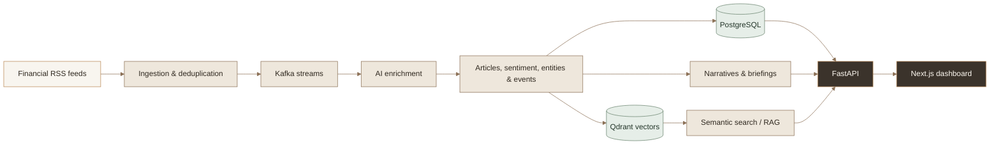

<div align="center">

# MarketIQ

### From financial headlines to market intelligence.

An AI-powered workspace that turns financial news into searchable, contextual insight—with sentiment, events, emerging narratives, company profiles, and market briefings.

<p>
  
  
  
  
  
</p>

[Get started](#-get-started) · [Explore features](#-what-you-can-do) · [Architecture](#-how-it-works) · [API](#-api-at-a-glance)

</div>

---

## ✦ The idea

Markets move quickly; useful context is scattered across feeds, companies, and events. **MarketIQ** brings that context together in one place. It ingests financial news, enriches it with AI, and makes the resulting intelligence available through a dashboard and a conversational search experience.

> **Collect → Enrich → Connect → Explore**

## ✨ What you can do

| Workspace | What it helps you explore |
|---|---|
| **Market pulse** | A snapshot of sentiment, notable events, sources, and developing narratives. |
| **News explorer** | Browse and filter enriched articles, then open an article for more context. |
| **Company intelligence** | Follow a ticker through related news, events, and sentiment. |
| **Narratives** | See related coverage grouped into broader market themes. |
| **AI briefings** | Review generated market summaries and key takeaways. |
| **Ask MarketIQ** | Ask questions in natural language and search indexed articles with RAG. |

The interface includes chart visualizations and sample-data fallbacks, so the dashboard can still be explored while live services or data are unavailable.

## 🧭 How it works



<details>
<summary><strong>See the processing stages</strong></summary>

1. **Ingest** articles from configured financial news feeds and remove duplicates.
2. **Enrich** articles with AI-assisted summaries, sentiment, entity extraction, event detection, and impact scoring.
3. **Store and connect** article records in PostgreSQL, embeddings in Qdrant, and pipeline messages in Kafka.
4. **Explore** the resulting intelligence in the dashboard, briefings, narrative views, and conversational RAG search.

</details>

## 🚀 Get started

### Requirements

- Docker with Docker Compose
- A [Groq API key](https://console.groq.com/keys) for LLM-powered features

### 1. Configure your environment

From the project root, copy the example configuration and add your key:

```bash
cp .env.example .env
```

On Windows PowerShell:

```powershell
Copy-Item .env.example .env
```

Set `GROQ_API_KEY` in `.env`. Review the other service and port settings there if your local environment needs different values. **Do not commit `.env` or paste API keys into source files.**

### 2. Start the stack

```bash
docker compose up --build -d
docker compose ps
```

Compose starts PostgreSQL, Kafka, Qdrant, the FastAPI backend, and the Next.js frontend.

### 3. Open MarketIQ

| Service | Address |
|---|---|
| Dashboard | [http://localhost:3000](http://localhost:3000) |
| API health | [http://localhost:8000/health](http://localhost:8000/health) |
| Interactive API docs | [http://localhost:8000/docs](http://localhost:8000/docs) |

To request an ingestion run after startup:

```bash
curl -X POST http://localhost:8000/api/v1/ingest
```

<details>
<summary><strong>Useful Docker commands</strong></summary>

```bash
# Follow service logs
docker compose logs -f backend frontend

# Stop services (named volumes and their data are retained)
docker compose down
```

</details>

## 🧩 API at a glance

The API is served under `/api/v1`; the FastAPI docs at `/docs` show request and response schemas.

| Resource | Route |
|---|---|
| Articles | `GET /api/v1/articles` |
| Events | `GET /api/v1/events` |
| Narratives | `GET /api/v1/narratives` |
| Market pulse | `GET /api/v1/market-pulse` |
| Latest briefing | `GET /api/v1/briefings/latest` |
| Chat | `POST /api/v1/chat` |
| Ingestion | `POST /api/v1/ingest` |
| Company profile | `GET /api/v1/companies/{ticker}` |

## 🛠️ Built with

| Layer | Technologies |
|---|---|
| Web app | Next.js 16, React 19, TypeScript, Tailwind CSS 4, Recharts |
| API | FastAPI, Pydantic 2, SQLAlchemy 2, async database drivers |
| AI & search | LangChain, Groq, Sentence Transformers, Qdrant |
| Streaming & persistence | Apache Kafka (KRaft), PostgreSQL |
| Local orchestration | Docker Compose |

## 🗂️ Project layout

```text
MarketIQ/
├── backend/
│   ├── app/
│   │   ├── agents/           # Ingestion and AI enrichment agents
│   │   ├── api/              # FastAPI route handlers
│   │   ├── infrastructure/   # Database, Kafka, Qdrant, embeddings
│   │   ├── models/           # Persistence models
│   │   ├── repositories/     # Data access
│   │   ├── schemas/          # API and domain schemas
│   │   └── services/         # Application services
│   ├── Dockerfile
│   └── requirements.txt
├── frontend/
│   ├── src/
│   │   ├── app/              # Dashboard and feature pages
│   │   ├── components/       # UI, charts, cards, and layout
│   │   ├── lib/              # API client and utilities
│   │   └── types/            # Shared frontend types
│   └── package.json
├── .env.example
└── docker-compose.yml
```

## 🎨 A note on the visuals

The dashboard uses a warm **Silk / Ash / Granite / Caramel** palette. This README uses GitHub-native Mermaid diagrams and expandable sections for visual exploration and interaction. GitHub sanitizes custom scripts and page styling in README files, so there are no fragile animation embeds or external animation widgets.

---

<div align="center">

**MarketIQ** · Turn the noise into a clearer market picture.

</div>
